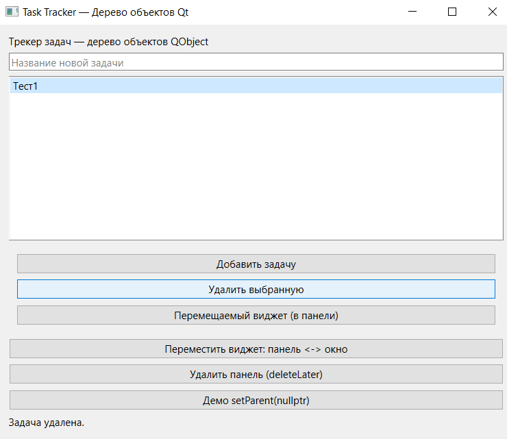
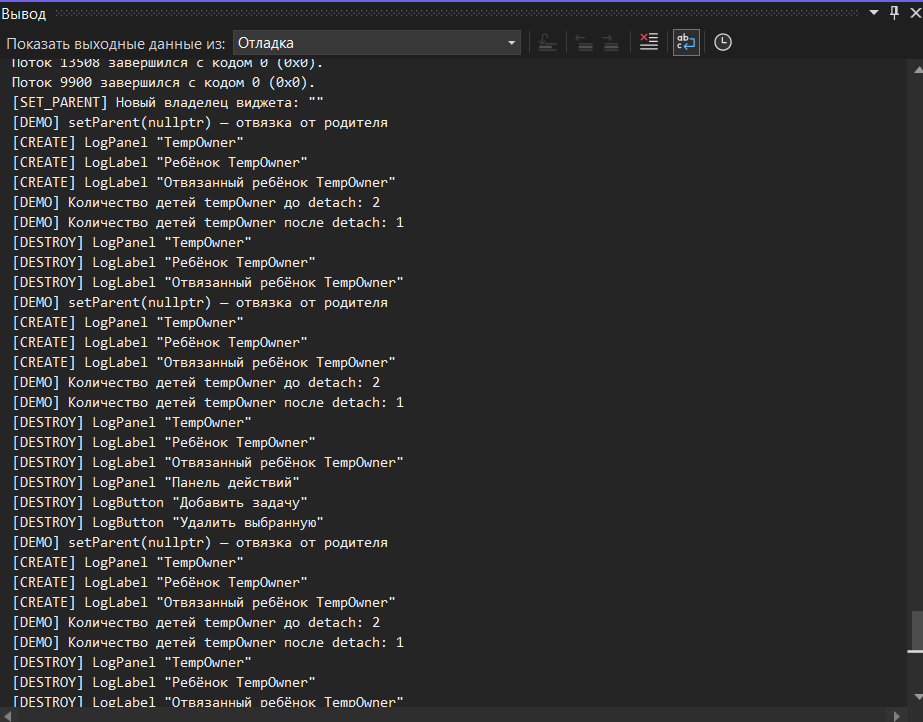

# Лабораторная работа №2. Дерево объектов QObject

**Дисциплина:** Основы кроссплатформенного программирования
**Тема:** Изучение дерева объектов QObject
**Вариант:** Сквозной проект — Трекер задач (Task Tracker)

**Выполнил:** Красненькин Р. А.
**Группа:** ПИЖ-б-о-24-1
**Направление:** 09.03.04 «Программная инженерия»

**Год:** 2026

---

## Цель работы

Изучить понятие дерева объектов `QObject`. Понять, как родитель владеет дочерними объектами. Научиться создавать виджеты с явным родителем. Реализовать окно с минимум 5 виджетами. Отследить создание и уничтожение объектов через `qDebug()` в деструкторах. Продемонстрировать автоматическое удаление дочерних виджетов при удалении родителя. Исследовать поведение `setParent()` при смене владельца виджета. Разобрать типичные ошибки, связанные с `setParent()`, удалением объектов и висячими указателями.

---

## Постановка задачи

Разработать GUI-приложение на Qt, демонстрирующее механизм **дерева объектов QObject** и **автоматического управления памятью** через родитель-ребёнок.

**Функциональные требования:**

- Главное окно с минимум 5 виджетами, связанными иерархией родитель-ребёнок.
- Производные классы виджетов с логированием создания и уничтожения через `qDebug()`.
- Демонстрация автоматического удаления дочерних виджетов при удалении родителя.
- Демонстрация `setParent(nullptr)` — отвязка виджета от родителя.
- Демонстрация `deleteLater()` — безопасное удаление виджета внутри обработчика сигнала.
- Демонстрация работы `QPointer` — безопасных указателей на виджеты.

---

## Теоретическое обоснование

**1. Дерево объектов QObject.** Практически все классы Qt наследуются от `QObject`. Каждый `QObject` может иметь **одного родителя** и **произвольное количество детей**. Это образует **дерево объектов**. Родитель владеет своими детьми — при уничтожении родителя Qt автоматически удаляет всех его детей.

**2. QWidget и двойное дерево.** `QWidget` наследует не только свойства `QObject`, но и добавляет визуальную иерархию. Родитель виджета одновременно является:
- владельцем объекта (управление памятью);
- визуальным контейнером (отображение внутри родителя);
- участником системы координат (позиция относительно родителя);
- элементом цепочки обработки событий (события сначала идут родителю).

**3. Метод setParent().** Функция `setParent()` позволяет изменить родителя объекта. Для виджетов это означает:
- смена владельца объекта;
- смена визуального родителя;
- возможный выход из старого layout;
- необходимость повторного добавления в новый layout;
- если передать `nullptr` — объект отвязывается и становится независимым. **В этом случае владелец должен удалить его вручную** через `delete` или `deleteLater()`.

**4. delete и deleteLater().**
- `delete` — удаляет объект **немедленно**. Опасно внутри обработчиков сигналов: объект может участвовать в текущем вызове стека.
- `deleteLater()` — ставит объект в **очередь на удаление**. Реальное уничтожение произойдёт, когда управление вернётся в цикл событий Qt. Это **безопасный способ** удалять виджеты внутри сигналов и слотов.

**5. QPointer.** `QPointer<T>` — это «умный» указатель, который автоматически становится `nullptr`, если объект, на который он указывает, был удалён. Это защищает от **висячих указателей** (dangling pointers) и позволяет безопасно проверять `if (!m_widget.isNull())` перед использованием.

**6. Порядок уничтожения.** В C++ деструкторы вызываются в **обратном порядке** относительно конструкторов. В дереве QObject дети удаляются **до** родителя. Поэтому в логе `[DESTROY]` сначала появятся сообщения от детей, потом — от родителя.

---

## Структура проекта

```
lab2-object-tree/
├── .gitignore
├── README.md                              ← этот файл
├── Lab2ObjectTree.sln                     ← решение Visual Studio
├── Lab2ObjectTree/
│   ├── Lab2ObjectTree.vcxproj
│   ├── Lab2ObjectTree.pro                 ← для qmake (совместимость с Qt Creator)
│   ├── main.cpp                           ← точка входа
│   ├── MainWindow.h / .cpp                ← главное окно
│   └── widgets.h                          ← производные классы с логированием
└── screenshots/
    ├── 01-window.png                      ← скриншот окна
    └── 02-debug-log.png                   ← скриншот лога
```

---

## Пример работы программы

### Скриншот 1. Главное окно трекера задач



Окно содержит:
- заголовок «Трекер задач — дерево объектов QObject»;
- поле ввода новой задачи;
- список задач (три тестовые записи);
- панель с кнопками «Добавить задачу», «Удалить выбранную», «Перемещаемый виджет»;
- кнопки управления демонстрацией;
- строку статуса.

### Скриншот 2. Лог создания и уничтожения объектов



В логе видны сообщения:
- `[CREATE] LogLabel "Трекер задач — дерево объектов QObject"` — создание заголовка;
- `[CREATE] LogButton "Добавить задачу"` — создание кнопки внутри панели;
- `[DEMO] setParent(nullptr) — отвязка от родителя` — запуск демонстрации;
- `[DEMO] Количество детей tempOwner до detach: 2` — до отвязки;
- `[DEMO] Количество детей tempOwner после detach: 1` — после отвязки;
- `[DESTROY] LogPanel "TempOwner"` — удаление панели;
- `[DESTROY] LogLabel "Ребёнок TempOwner"` — автоматическое удаление ребёнка, оставшегося в дереве.

---

## Разбор ошибок и их решений

**1. Проблема с кодировкой кириллицы в консоли Visual Studio.**
При первом запуске программы русский текст в окне «Вывод → Отладка» отображался знаками вопроса и «кракозябрами». Причина — несовпадение кодировок: исходные файлы `.cpp`/`.h` сохранялись в UTF-8 без BOM, а компилятор MSVC читает их как CP1251. Решение: все файлы сохранены в кодировке **UTF-8 with BOM**, в свойствах проекта добавлен флаг компилятора **`/utf-8`**. После этого русский текст в логе отображается корректно.

**2. Двойное удаление при передаче стекового объекта в parent (типичная ошибка).**
Частая ошибка — создавать виджет **на стеке** и делать его ребёнком **кучного** объекта:

```cpp
QWidget parent;
QLabel label("text", &parent);   // label на стеке
```

При выходе из функции `label` удалится сам (как локальная переменная), а `parent` попытается удалить его повторно при своём разрушении — это приведёт к падению программы. **В нашем коде** все виджеты создаются через **`new`** и являются детьми `this` — двойного удаления не происходит.

**3. Утечка памяти после `setParent(nullptr)` (типичная ошибка).**
После отвязки виджета от родителя через `setParent(nullptr)` **никто им не владеет**. Если не удалить его вручную — объект останется в памяти до конца работы программы (утечка). **В нашем коде** в `demoDetaching()` после `child2->setParent(nullptr)` явно вызывается `delete child2` — утечки нет.

---

## Вывод

В ходе лабораторной работы изучено понятие **дерева объектов QObject** и продемонстрирован механизм **автоматического управления памятью** через родитель-ребёнок. Реализовано окно трекера задач с **11 виджетами**, связанными иерархией родитель-ребёнок. Каждый виджет — производный класс с логированием создания и уничтожения через `qDebug()`.

Продемонстрировано:
- **автоматическое удаление детей** при удалении родителя (панель `LogPanel` и её кнопки удаляются каскадом);
- **изменение владельца** через `setParent()` — перемещаемый виджет переходит из панели в главное окно и **не удаляется** вместе с панелью;
- **отвязка** через `setParent(nullptr)` — виджет становится независимым и требует ручного удаления;
- **безопасное удаление** через `deleteLater()` — внутри обработчика сигнала;
- **защита от висячих указателей** через `QPointer<T>`.

Программа работает корректно: при запуске создаются все виджеты, при закрытии — удаляются в обратном порядке. Логи `[CREATE]` и `[DESTROY]` в окне «Вывод → Отладка» подтверждают работу дерева объектов.

**Ссылка на Git-репозиторий:** https://github.com/Justake206/lab2-object-tree

---

## Контрольные вопросы

**1. Что такое дерево объектов QObject?**
Дерево объектов QObject — это иерархия объектов, в которой каждый объект, унаследованный от `QObject`, может иметь одного родителя и произвольное количество детей. Связь «родитель-ребёнок» устанавливается либо через конструктор (передача `parent`), либо через `setParent()`. Родитель владеет своими детьми и автоматически удаляет их при собственном разрушении.

**2. Зачем нужно дерево объектов в Qt?**
Дерево объектов решает три задачи: **управление памятью** (родитель удаляет детей автоматически), **организация иерархии** (визуальной для виджетов, логической для других объектов) и **распространение событий** (события сначала идут родителю, потом детям). Это освобождает программиста от ручного `delete` в большинстве случаев.

**3. Кто такой «родитель» в терминах QObject?**
Родитель — это объект-владелец, который хранит список своих детей и удаляет их при собственном разрушении. Родитель может быть только один. Установить родителя можно двумя способами: передать его в конструктор (`new QLabel("text", parent)`) или вызвать `setParent(parent)`.

**4. Что произойдёт, если не указывать родителя?**
Объект будет существовать **независимо** — за его удаление будет отвечать программист. Если такой объект создан через `new` и не удалён вручную — возникнет **утечка памяти**. В нашем коде все виджеты создаются с явным родителем.

**5. Как узнать детей объекта?**
Метод `children()` возвращает список `QObjectList` всех детей объекта. Метод `findChildren<T>()` возвращает детей определённого типа (например, `findChild<QListWidget*>("taskList")`). В нашем коде используется оба: `children().size()` в `demoDetaching()` и `findChild<QListWidget*>()` в `addTask()`.

**6. Чем `findChildren<QWidget*>()` отличается от `children()`?**
`children()` возвращает **всех** детей объекта (любого типа, наследников `QObject`). `findChildren<QWidget*>()` — только тех детей, которые являются `QWidget` (или его наследниками). Первый метод быстрее, второй — удобнее для работы с виджетами.

**7. Можно ли иметь у объекта несколько родителей?**
**Нет.** У `QObject` может быть только **один родитель**. При вызове `setParent(newParent)` объект автоматически удаляется из списка детей старого родителя и добавляется в список детей нового.

**8. Что произойдёт при удалении родителя?**
Все **дети** родителя будут удалены **автоматически** через их деструкторы. Это и есть основное преимущество дерева объектов. Дети удаляются **до** родителя — сначала вызываются деструкторы детей, потом самого родителя.

**9. Что делает метод `setParent()`?**
Меняет родителя объекта. Старый родитель «теряет» этого ребёнка, новый — «получает». Для виджетов `setParent()` дополнительно меняет визуального родителя: виджет открепляется от старого layout и должен быть добавлен в новый **вручную**.

**10. Что произойдёт при `setParent(nullptr)`?**
Объект **отвязывается** от родителя и становится **независимым**. За его удаление теперь отвечает программист. Если не удалить его вручную — возникнет утечка памяти. В нашем коде `demoDetaching()` показывает это: `child2` отвязывается и удаляется через `delete child2`.

**11. Чем `delete` отличается от `deleteLater()`?**
`delete` удаляет объект **немедленно**. `deleteLater()` ставит его в **очередь на удаление** — уничтожение произойдёт, когда управление вернётся в цикл событий. Внутри обработчиков сигналов и слотов **предпочтительно использовать `deleteLater()`** — потому что объект может участвовать в текущем вызове стека.

**12. Почему в работе используется `QPointer`, а не обычные указатели?**
`QPointer<T>` — это «умный» указатель, который **автоматически становится `nullptr`**, если объект, на который он указывает, был удалён. Это защищает от **висячих указателей**: перед использованием можно проверить `if (!m_widget.isNull())`. Обычный указатель после удаления объекта останется «висячим» — обращение к нему приведёт к неопределённому поведению.

**13. Что произойдёт, если виджет-ребёнок удалить через `delete`?**
Родитель автоматически удалит его из своего списка детей. Ошибки не будет — Qt корректно обрабатывает удаление детей вручную. Но если удаление происходит **внутри обработчика сигнала этого же виджета** — программа может упасть. Поэтому используется `deleteLater()`.

**14. Что такое висячий указатель?**
Висячий указатель (dangling pointer) — указатель, который ссылается на уже удалённую память. Обращение к нему — **неопределённое поведение** (часто падение программы). Возникает, например, если объект удалён через `delete`, а указатель на него остался. Решение — использовать `QPointer`.

**15. Как отвязать виджет от родителя, но не удалять его?**
Вызвать `setParent(nullptr)`. Виджет станет независимым. Но после этого за его удаление отвечает программист — если не удалить, возникнет утечка.

**16. Как проверить, кто родитель виджета?**
Метод `parentWidget()` возвращает `QWidget*` — родителя-виджета. Метод `parent()` возвращает `QObject*` — родителя вообще. В нашем коде `m_movable->parentWidget() == m_panel.data()` используется для проверки, где сейчас находится перемещаемый виджет.

**17. Что произойдёт, если попытаться сделать родителем объект из другого потока?**
Qt **не разрешает** делать родителем объект из другого потока — это приведёт к предупреждению или падению. Дерево объектов привязано к потоку, в котором создан родитель. Все дети должны быть в том же потоке.

**18. Как связано дерево объектов и цикл событий Qt?**
События в Qt распространяются **по дереву объектов**: сначала событие идёт родителю, потом детям. `deleteLater()` работает через цикл событий — объект удаляется, когда очередь событий доходит до его удаления. Без `app.exec()` (цикла событий) `deleteLater()` не сработает.

**19. Почему для GUI-приложения нужен QApplication и app.exec()?**
`QApplication` инициализирует GUI-подсистему Qt (окна, события, шрифты, стили). `app.exec()` запускает **цикл событий** — без него окно не будет реагировать на клики, не будут работать таймеры, `deleteLater()` и другие асинхронные механизмы.

**20. В каком порядке вызываются деструкторы в дереве QObject?**
Сначала вызываются деструкторы **детей**, потом — **родителя**. Дети удаляются в **обратном порядке** относительно их создания. В нашем логе это видно: последний созданный виджет удаляется первым.

**21. Что такое `objectName` и зачем он нужен?**
`objectName` — это строковый идентификатор объекта. Используется для поиска через `findChild<T>("name")`, для отладки (в логах), для QSS-стилей. В нашем коде `taskList` имеет `objectName`, чтобы `findChild<QListWidget*>("taskList")` мог его найти.

**22. Что произойдёт, если удалить родителя вручную?**
Все его дети удалятся **автоматически**. В нашем коде `delete tempOwner` приводит к автоматическому удалению `child1` — об этом свидетельствует лог `[DESTROY] LogLabel "Ребёнок TempOwner"`.

**23. Можно ли передать `this` в качестве родителя в конструкторе?**
Да, это стандартный приём. `new QLabel("text", this)` — виджет становится ребёнком текущего объекта. При удалении `this` виджет удалится автоматически. В нашем коде так создаются почти все виджеты.

**24. Зачем нужна проверка `if (!m_widget.isNull())`?**
Это защита от **висячего указателя**. `QPointer` автоматически становится `nullptr`, если объект удалён. Проверка `isNull()` позволяет избежать обращения к удалённому объекту и падения программы. В нашем коде такие проверки есть в `setStatus()`, `moveMovableWidget()`, `deletePanel()`.

**25. Почему в `deletePanel()` используется `deleteLater()`, а не `delete`?**
`deletePanel()` вызывается **внутри обработчика сигнала** `QPushButton::clicked`. Если удалить панель через `delete` немедленно, она может участвовать в обработке текущего события — это приведёт к падению. `deleteLater()` безопасен: удаление произойдёт, когда управление вернётся в цикл событий.

---

## Ссылка на репозиторий

**GitHub:** https://github.com/Justake206/lab2-object-tree

---

## Лицензия

Учебный проект. Свободное использование в образовательных целях.